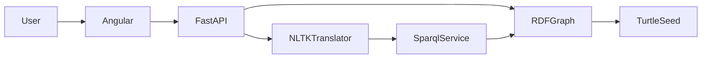

# Architecture

- Angular: graph exploration, NLP question page and CRUD/SPARQL administration
- FastAPI: public REST, NLP, SPARQL and reasoner endpoints
- RDFGraph: ontology + generated seed data
- NLTKTranslator: TweetTokenizer + SnowballStemmer, French/English lexicons, slot extraction, safe SPARQL templates
- NLP does not call an LLM API; RDFLib executes the generated SPARQL on the current graph
